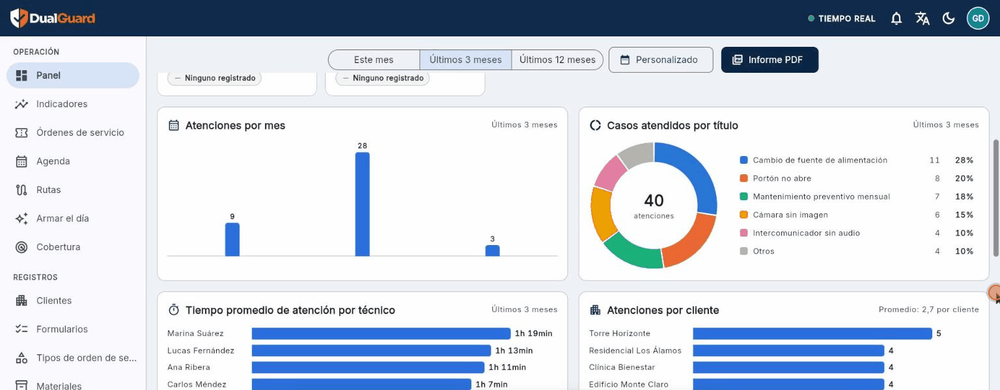
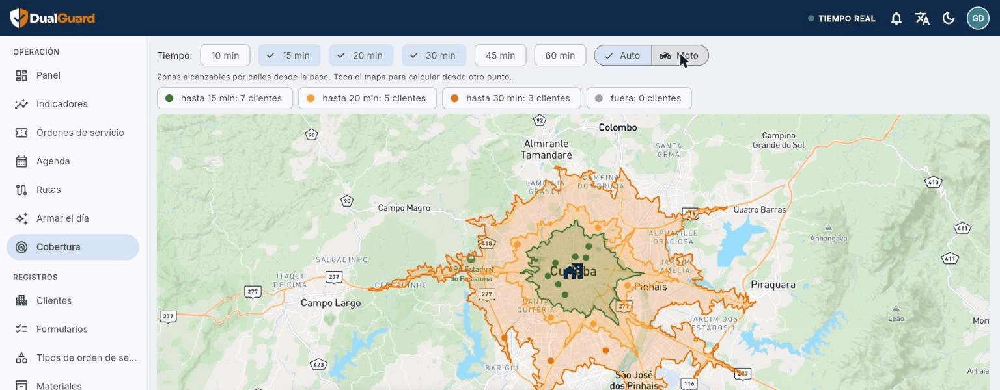
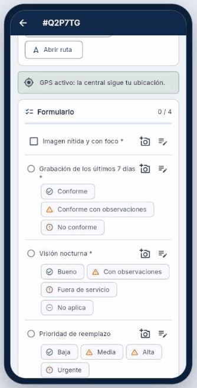

<h1 align="center">Hola, soy Juan Becerra 👋</h1>

  <b>Desarrollador Flutter</b> y fundador de <b>DualGuard</b>, una plataforma para empresas de servicio técnico. 
  📍 Curitiba, Brasil · 🌎 Español · Português

---

## 🛡️ DualGuard

Sistema completo para empresas que hacen **instalación y mantenimiento en la calle**:
seguridad electrónica, portería remota, cámaras, portones, ascensores, climatización…

- **Panel para la oficina** (Windows y web): órdenes de servicio, agenda, rutas preventivas,
  indicadores, clientes, formularios, materiales y presupuestos.
- **App del técnico** (Android): GPS en tiempo real, formularios, fotos, materiales,
  firma del cliente e informe en PDF, **funciona sin conexión**.
- **Rutas por las calles**: "Armar el día" reparte las órdenes entre los técnicos y ordena
  cada recorrido por el menor tiempo de manejo; "Cobertura" muestra hasta dónde llega el
  equipo en 15, 30 o 45 minutos (auto o moto).
- **Multiempresa**: cada empresa con su servidor, prueba gratis y consola de administración.
- En **español, portugués e inglés**, con la moneda de cada país.

  

<table>
  <tr>
    <td width="68%"></td>
    <td width="32%"></td>
  </tr>
  <tr>
    <td align="center">Cobertura: zonas a 15/20/30 min por calles desde la base</td>
    <td align="center">App del técnico: formulario de la visita</td>
  </tr>
</table>

Imágenes con datos de demostración.

---

## 🧰 Tecnologías

  
  
  
  
  
  
  
  
  
  
  
  

- **Apps**: Flutter para Android, Windows y web desde un solo código; Riverpod, go_router,
  modo offline, PDF, mapas y GPS.
- **Servidor**: PocketBase con reglas de acceso y automatizaciones, en Docker sobre AWS,
  publicado con Cloudflare; backups automáticos en S3.
- **Mapas**: rutas, tiempos y zonas por las calles con un servidor de rutas propio.
